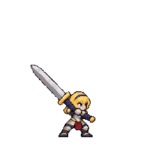

# 像素造物台 · Pixel Atelier

像素角色的本地动画工作台。用一张角色参考图制作一套游戏动作，逐帧微调后导出透明 GIF、PNG 帧、精灵图集和时序配置。



## 制作流程

1. **新建角色**。使用七方向弓箭手模板、空白工程、女骑士样板或透明立绘。
2. **制作待机**。填写角色特征、画风、装备和动作要求，调用自定义生图 API。待机支持上传最多 4 张参考图，或从其他角色已定稿的待机母版预览并导入；多图会合成一张参考表。导入母版只作为参考，当前角色仍需生成待机并定稿。任务完成后按请求排版自动切帧、保存并进入动作编辑。
3. **定稿母版**。选择一帧作为角色母版并冻结色板，后续动作沿用同一人物、装备与配色。待机编辑页会保留吸顶入口，可随时更新当前母版或改用另一段待机；已生成动作不会自动重绘。
4. **扩展动作**。从动作列表选择待制作动作，或新增、复制、排序自定义动作。
5. **微调与导出**。播放、逐帧调整时长和偏移，导出透明 GIF、PNG 帧、精灵图集、色板与时序配置 ZIP。

角色工程会自动保存。全局导航只保留「作品」和「参考库」；「创作」「动作编辑」「交付检查」属于当前角色，打开角色后才显示。角色与动作 ID 固定在路由中，例如 `/projects/:projectId/actions/:actionId/editor`，刷新或直接打开链接会加载对应工程；进入作品页后不保留“当前角色”身份。已生成动作可以在创作页查看原始 ACTION SHEET，也能直接进入帧编辑。生成失败或切帧异常时，页面会保留结果并提供手工排版重试入口。

## 在本地跑起来

需要 Python 3.9+、Node.js 22+ 和 pnpm。先安装 Python 依赖，再构建 Vue 前端：

```bash
git clone https://github.com/jinxingtaire/pixel-atelier.git
cd pixel-atelier
python3 -m venv .venv
source .venv/bin/activate
python -m pip install -r requirements.txt
pnpm install
pnpm build
python bridge/server.py
```

Windows PowerShell 可以用 `.venv\Scripts\Activate.ps1` 激活环境。打开 [本地工作台](http://127.0.0.1:8898/)，点 **「女骑士样板」** 直接体验编辑与导出。生成自己的新动作需要先在右上角 **「API 设置」** 中配置 OpenAI 兼容的生图 API；有参考图时调用 `/v1/images/edits`，纯文字待机调用 `/v1/images/generations`。可选的文本模型用于在生成前润色提示词，失败时自动使用原文。GPT 图片模型返回临时图片链接；下载中断时会保存链接并支持 Range 续传，页面可点「继续下载（不重新生图）」，不会重复提交生图请求。

开发前端时，先运行 `python bridge/server.py`，再在另一个终端执行 `pnpm dev`。Vite 开发服务位于 `http://127.0.0.1:5173/`，API 请求代理到 `127.0.0.1:8898`。生产运行使用 `pnpm build` 后的静态文件。

## 女骑士示例

金发双手巨剑女骑士有八段动作、共 80 个关键姿势。下砸命中后压低身体，再蹬腿转胯，把剑从低位带到头顶。源码里的示例保留透明图集、原生像素尺寸、帧时长和锚点，方便观察角色比例、武器长度和动作衔接。[示例素材与来源](examples/knight/README.md) · [制作复盘](examples/knight-retrospective.md)

## 本地 Mock 与测试

不调用外部 API 也可以验证完整流程。Mock 服务会返回仓库中的女骑士 4 × 2 样例图表：

```bash
python tools/mock_api.py --port 8901
pnpm test:unit
pnpm test:e2e
```

在「API 设置」中填写 `http://127.0.0.1:8901/v1`、任意本地 Key（例如 `sk-mock-local`）和模型 `mock-sprite-sheet`。`pnpm test:e2e` 会自动启动隔离的后端、Mock 服务和浏览器，验证自动切帧、编辑保存、母版冻结、第二个动作、下载中断后的无重生成续传与 GIF/ZIP 导出；本机优先复用 Chrome，也可通过 `PLAYWRIGHT_CHROMIUM_EXECUTABLE` 指定浏览器。

## 工具和文档

- [工作台使用说明](docs/像素造物台-v0.5.md)
- [制作流程](docs/workflow.md)与[动作简报模板](templates/action-brief.md)
- [CLI 配置](docs/configuration.md)与[游戏接入约定](docs/engine-integration.md)

工作台后端在 `bridge/`，Vue + TypeScript + Naive UI 前端在 `frontend/`。状态、服务、纯函数、组件和页面按职责分目录组织。`spritepipe/` 是独立的资源构建和检查 CLI，可用合成校准图演示完整流水线：

```bash
python -m spritepipe demo work/calibration-demo
python -m spritepipe check work/calibration-demo
python -m unittest discover -s tests
pnpm test:unit
pnpm test:e2e
```

导出配置可用来设置引擎中的播放时序和根节点。角色观感、攻击范围和打击反馈需要在游戏中复核。欢迎贡献带最小复现的修复和引擎适配。[贡献说明](CONTRIBUTING.md)

代码与文档采用 [MIT License](LICENSE)。工作台的私人项目、上传图、生成记录和导出保存在被 Git 忽略的 `work/` 目录。
