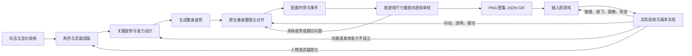

# 完整人物像素动作制作流程

状态：可复用的生产与验收流程草案。2026-11-07，根据金发巨剑女骑士从参考图到实机的过程整理；尚无跨多个新角色的生成通过率数据。文中把已经发生的案例、当前执行规则、下一轮建议分别标明。它约束交付质量与返工路径，不承诺模型一次生成成功。

适用当前路线：横版2D、整身逐帧像素人物、原地动作、代码负责世界移动。角色的头、身体、手脚、关节和武器不拆开拼装。其他朝向、骨骼或独立武器方案需要另立规格，不能在当前路线失败后悄悄切换。

## 从哪里开始

- 新角色：填[角色规格模板](../templates/character-brief.json)，锁定角色和武器母版，再填[动作简报](../templates/action-brief.md)。
- 开始做图：先用一段高风险短动作验证角色、武器和发力，再扩整套动作。
- 准备交付：走[验收清单](../templates/review-checklist.md)，文件检查、视觉检查、引擎检查分别记录。
- 看实际依据：[金发巨剑女骑士复盘](../examples/knight-retrospective.md)。

## 流程总览



流程可以反复回退。生成成功、脚本PASS、GIF能播放，分别只能证明对应步骤完成。

## 1. 先定游戏约束

先回答角色如何进入游戏，避免全部画完才改规格。

| 要定的事 | 要写到规格里的内容 |
|---|---|
| 视角与朝向 | 横版/俯视；需要哪些方向；是否允许镜像；非对称装备如何处理 |
| 画面里的实际大小 | 原生站姿高度、头部宽度、游戏绘制倍率；相机倍率单独记录 |
| 风格 | 头身比、轮廓、描边、像素簇、材质明暗层级、固定色板 |
| 武器 | 剑尖至护手长度、剑宽、握柄长度与轴线、双手握点；用原生像素和人体比例同时说明 |
| 画布与锚点 | 每个动作的画布尺寸、逻辑根节点pivot；必要时允许扩画布 |
| 位移职责 | 原地姿态、局部屈膝和倾身由美术表达；世界移动、跳跃轨迹、击退和挑飞由代码处理 |
| 状态与输入 | 必做动作、优先级、入口出口、循环、保持、接招窗口 |
| 交付格式 | PNG逐帧、图集、JSON、预览GIF、报告、实机片段 |

角色图表中的列数、每个动作的姿势数、朝向数量是三个独立参数。当前横版先做右向；允许的左向由引擎围绕角色根节点翻转。俯视多方向角色另列方向矩阵，导出格式按目标引擎与版本核对。

## 2. 锁定角色与武器母版

母版包至少包含：用户选定的身份图、目标原生网格的整身就绪帧、轮廓与配色、武器尺寸与握法、允许的朝向、版本号。

逐项看清：发型与脸、头身比例、躯干宽度、肩甲和护甲分块、手套和靴子、衣物装饰、武器轮廓。每轮只传与当前任务有关的参考，明确标注哪张决定身份、哪张决定姿势、哪张是待修改目标。

**武器加长属于母版变更。** 一段连招换了特大巨剑，先检查待机、奔跑、闪身、跳跃、重攻击和受击是否仍带旧剑；跨动作混用时不能宣布整套装备已统一。更换武器尺寸后升级weapon_revision，列出受影响动作。

当前默认整身路线；只有用户明确选择新方案时才引入拆件或独立武器。失败方案归档并标明停用，不能与当前运行资源一起打包。

退出本阶段：母版与原生规格有明确选择记录；若仍为候选图，标记为候选，不把技术检查当成人工确认。

## 3. 先设计动作语义，再列帧

为每个动作写清：起势、蓄势、发力、命中、随挥、回收。具体姿势数按动作需要定，8或16不是固定门槛。

动作简报必须说出：

- 哪只脚支撑，哪只脚推动；髋、膝和肩如何带动；重心最低和最高在哪里。
- 双手是否一直握住同一根直柄；剑尖、护手和握点按什么路线经过。
- 命中在哪里，停顿多久，惯性最终由哪些关节和姿态吸收。
- 从前一个动作如何进入，结束回哪个姿势，能否中断或接招。

大剑案例的动作语义：

| 阶段 | 身体与剑的关系 | 审核重点 |
|---|---|---|
| 下砸准备 | 屈膝、沉胯，双手把剑带到高位 | 重武器有准备动作 |
| 下砸命中 | 蹬地、转胯、胸肩向前压，剑落到前方地面 | 剑路连续，落点与身体受力对应 |
| 入地与重装 | 膝髋压缩吸收冲击，剑保持低位；身体重新蓄力 | 不在两击之间突然把剑重置回肩 |
| 上挑爆发 | 腿推动髋，腰胸展开，肩臂带起剑 | 发力贯穿全身；刀光从低处升到高处 |
| 高位随挥 | 伸展身体，剑继续上行；头发衣物滞后 | 有把重物掀起的方向感 |
| 收势 | 屈膝、屈肘吸收惯性，再回就绪 | 不能从最大伸展瞬移回待机 |

先审几个决定动作含义的关键姿势，再补过渡。当前女骑士实际曾整表生成后返工，下一轮提前审关键姿势是改进建议，尚未统计其节省工时。

## 4. 使用图像生成工具画完整姿势

实测案例使用内置imagegen。流程也可接收其他工具绘制的完整透明PNG；当前CLI只处理本地PNG，图像生成由使用者选择并执行。透明请求显式要求透明背景。提示词同时引用角色母版、武器规格与当前动作简报，使用[动作简报与提示词模板](../templates/action-brief.md)。

一组只做一种动作或一段明确连招。写明顺序、格数、每格宽高比例和安全留白，避免顺序靠猜。剑或刀光横向很宽时可用宽单元格，后处理保持源图纵横比，不能直接压成正方形。

生成图作为候选源图保存，提示词、参考图、选中版本与弃用原因一起留档。逐格先查：

1. 人物、脸、头身和服装是否仍是同一个角色。
2. 手脚数量、遮挡、双手握柄、关节连接是否成立。
3. 剑刃、护手和柄的轴线与尺寸有无跳变；旧位置是否残留第二把剑。
4. 剑路和全身受力是否连续；上挑是否真的抬升到高位。
5. 主体、剑和刀光是否在源格内完整；已经在源图中裁掉的内容，后面补透明画布救不回来。

一次只针对明确缺陷迭代。个别关键帧可以用新生成的**完整角色姿势**替换；记录来源和采样尺度，不能在替换中夹入不同角色、旧武器或拆件。

## 5. 整理原生像素，不改变人物比例

处理范围：切格/裁框、保留纵横比的统一采样、透明清理、冻结色板映射、整像素整帧平移、图集和时序配置。人物不能为适应每格包围盒而逐帧缩放。

| 参数 | 规则 |
|---|---|
| 像素网格 | 以原生尺寸审核方形像素簇；大图上有方块纹理不自动合格 |
| 采样 | Nearest/Point；预览尽量整数倍 |
| 角色尺度 | 每个源动作表校准一次，和母版站姿比较；组内固定，整身替换表单独校准并复核 |
| 色板 | 使用同一份冻结色板；不可每批重新自动生成色值 |
| Alpha | 当前严格像素方案使用0/255，确保同时存在主体和透明区 |
| 留白 | 人物尺度固定，剑和特效装不下时扩画布并同步调整pivot |
| 源格边界 | 检查源图也未裁掉内容，不能只检查导出PNG有留白 |

64色是这次女骑士整理后的案例值，不是所有像素画的通用要求。强制色板映射和Alpha阈值不能证明轮廓、脸和材质还正确；处理后要再看原生图。

## 6. 对齐：先判断姿态，分别看根节点、躯干与支撑脚

引擎中的逻辑根节点固定，脚尖、躯干、头部在动作中可以发生有意变化。对齐时不要把它们混为一件事。

- 待机：用稳定支撑脚和身体参照，保留设计内的呼吸。
- 跑步：对照一个完整步态的头脸、腰部、支撑脚与腾空帧。来源图存在意外整体漂移时，整帧校正；不能把每帧最低脚尖都强拉到一条线。
- 蓄势和重攻击：保留有意的深蹲、前倾、伸展；不能用头顶固定规则把全身发力抹平。
- 跳跃：空中姿态与代码轨迹分工明确；GIF预览加的示意曲线不能再次烘进运行PNG。
- 倒地：允许轮廓变矮变宽，用落地关系与状态末帧校准，不能拉回站立高度。
- 镜像：先以角色根节点建立局部坐标，再做朝向翻转；不能翻转画布后继续使用不对称的旧锚点。

**单一锚点或单个指标不构成通过。** 同时看低速逐帧、实际速度循环和有地面的游戏。头腰抖动、支撑脚穿地/滑动、脚步次序、首尾衔接分别检查。若整帧平移无法同时修好躯干与接地，退回重画对应完整姿势，不能只追求一个更小的抖动数字。

女骑士跑步腰部范围从约7.50像素降至1.28像素，只说明该指标改善；它不能单独证明步态、足底接地和美术已通过用户最终确认。

## 7. 配时长、循环和游戏事件

分别记录：独立关键姿势数、每姿势停留时长、GIF编码时间步、游戏更新帧率。复制同一姿势增加编码帧数不会补出新的动作信息。

为蓄势、释放、命中、随挥、收势分别配时长。攻击动作至少记录命中姿势与有效窗口；多段攻击每段独立去重。蓄力保持、倒地保持、单次动作回待机、输入接招与取消窗口都由状态机明确管理。

女骑士连段案例：16个关键姿势、1640ms，GIF用20ms时间步编码为82帧；下砸在420ms，上挑在920ms。参数是本次结果，换角色与武器后重新调，不能照抄成通用标准。

配置至少包含：动作id、原生尺寸、逐帧rect/duration/pivot、root_motion、循环策略、入口出口、命中与保持事件、参考与版本来源。

## 8. 在造物台审片并交付

从工作台「交付」切换当前动作。按游戏里的绘制倍率从原速开始看，重点看轮廓、接地、发力和收势。半速或四分之一速用来定位问题。所有帧共用同一画布、地面参考线与根节点位置。深色、浅色和棋盘格用于复查边缘，预览倍率和播放速度只作用于审片。

1. **先查关键姿势。** 早期先审起势、发力、接触和随挥。补齐中间帧后，检查完整动作与首尾衔接。下砸看触地和压缩，上挑看全身发力与向上随挥，跑步看支撑脚和重心是否合理交替。
2. **再查文件。** 自动检查会定位空白帧、画布越界、源格贴边、透明背景、锚点和时长问题。直接从问题跳回对应帧。源格贴边需要人工确认是否真的裁断。
3. **标记游戏事件。** 在接触或释放开始的帧打标记。巨剑上下两击可各标一次。弓箭手看箭离弦，法师看施法释放。调整帧时长后，事件时间会跟随累计时长更新。
4. **按动作确认。** 同一动作和画面版本会记住人工勾选。编辑帧、时长、锚点、事件或角色规格后，重新检查。发现身份、装备结构或发力问题时，回到母版和整身关键姿势重画。
5. **导出后进游戏。** 带上动作配置和技术报告，用原游戏复查判定距离、事件时机、镜像和动作切换。记录引擎版本及实机证据。

审片流程参考了 Character Factory 的游戏尺寸预览与固定机位关键帧审查。 [Character Factory Skills](https://github.com/luccacerfz/character-factory-skills)

### 预览与运行资源

预览轨：GIF、原生尺寸/整数倍接触表、黑白与棋盘背景、逐帧母版对照。

运行轨：原生透明PNG、图集PNG、JSON配置、固定色板、来源与版本清单。GIF便于看效果，游戏内按原生帧和配置播放。

```text
character/
  profile.json
  reference/                 # 身份、像素母版、武器母版、版本记录
  palette.json
  source/                    # 生成原图；保留完整格边界
  prompts/                   # 实际提示词、参考图职责、迭代与选图
  actions/<action>/<direction>/
    frames/*.png
    atlas.png
    animation.json
  previews/
  qa/                        # 自动检查与视觉证据分开
  integration/               # 游戏入口、测试结果、实机片段
  archive/                   # 明确停用原因，不混入当前运行包
  delivery.json
```

目录是下一批模板；当前案例目录名与结构有历史差异，用其delivery与动作配置解释，避免为了整齐移动已经被游戏引用的文件。

## 9. 回到原游戏验收

可由素材制作与游戏接入两个角色协作，也可同人完成；分别记录美术交付与引擎验证。使用Agent会话协作时，先明确用户授权的任务范围，再传递资源与交接结果。

实机检查必须覆盖：

- 不同动作画布尺寸切换时人物仍同尺度、同根节点；像素采样与镜像正确。
- 攻击有效窗口对上实际接触；判定根据刀刃扫过的范围，而非整张画布或完整光圈。
- 下砸有接触反馈，上挑有真实敌人上升、重力下落与落地；同段不重复结算伤害。
- 已包含在角色帧中的刀光不重复叠加旧刀光；新增命中火花对应实际接触。
- 攻击未命中、敌人已死亡、空中死亡、左右朝向、状态退出和蓄力松键都正常。
- 原有移动、跳跃、受击、掉装和关卡流程不因换美术失效。

技术测试、视觉复核、用户确认分别留状态。演示录屏若使用无敌或高血量敌人，要标明固定测试场景；它能证明动作与物理效果，不证明自然难度平衡。

## 10. 失败退回与冻结版本

| 现象 | 优先回到哪里 | 停止使用的补救方式 |
|---|---|---|
| 脸、比例、服装换了人 | 母版与生成约束 | 用程序拼一个相似人物顶替 |
| 剑长短跳变、柄歪、旧剑残留 | 武器母版与完整姿势重画 | 缩小身体、模糊插帧掩盖 |
| 下砸后上挑像挥手腕 | 关键姿势和受力设计 | 只把刀光做大 |
| 源格已裁掉剑或光 | 生成布局与完整姿势 | 导出时补透明边后宣布完整 |
| 跑动跳一下、腰部漂移 | 语义对齐与整姿态检查 | 对齐包围盒中心或每帧最低脚尖 |
| 换动作人物变小 | 原生尺度、画布、pivot与引擎绘制 | 按画布大小统一缩放 |
| 刀光碰到但没有伤害/隔空伤害 | 刀路、事件窗口、判定和朝向 | 用整个光圈作为碰撞体 |
| 上挑特效上升但敌人不动 | 敌人受击状态与物理 | 只冻结敌人或播放升空粒子 |

冻结时写下角色版本、武器版本、每组动作版本、来源、实际验收状态和已知缺口。技术通过后可以标记可测试版本；需要用户确认的画风与手感，继续标记待复核。

## 下一轮怎么衡量稳定性

从下一位角色开始记录：请求动作数、生成调用数、首次可用动作数、完整姿势重画数、语义退回数、自动检查失败项、技术通过后的视觉退回数、实机问题数和总工时。

首次可用率需预先定义“无需重画且完成视觉与技术检查”的口径。当前案例没有完整的各阶段工时和全量首次通过统计，不填造出来的成功率。也尚未证明该规范适用于独立4/8方向、其他武器或严格商用量产。
